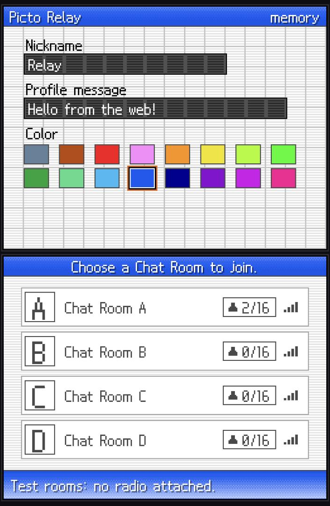
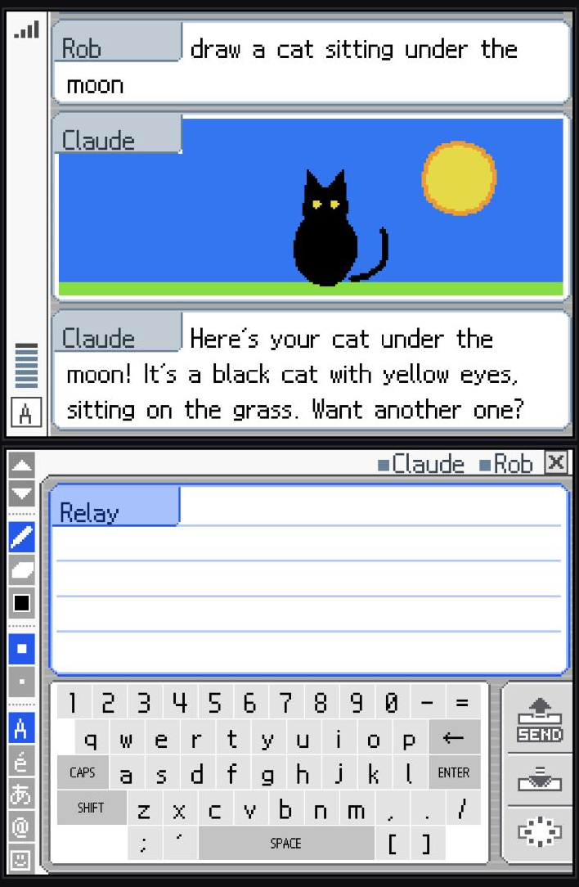
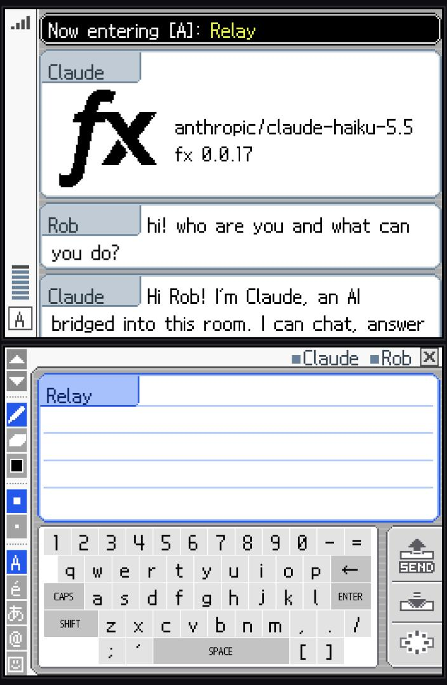

# Picto Relay

Chat with a Nintendo DS running PictoChat from a browser, a JSON API, or a
language model. An ESP32 on USB is the radio: it joins the room a DS has open
and carries messages both ways.

<p align="center">
  
  
  
</p>

## Get started

Install Rust, Node.js 22.18 or newer, and [just](https://just.systems)
(`brew install just`).

**Without hardware.** Rooms live in memory; open it in two tabs to chat.

```sh
just server-memory
```

Then open http://localhost:3001.

**With a DS.** Plug in an ESP-WROOM-32 and flash it, once:

```sh
just espressif          # download ESP-IDF into .esp/ (about 2 GB)
just firmware-upload    # build the firmware and flash the ESP32
```

Open PictoChat on the DS, enter a room, and start the server:

```sh
just server
```

Then open http://localhost:3001 and join the same room.

**With a model in the room.** The [bot](services/bot/README.md) hosts a language model
that people on the DS can talk to and ask for drawings. It reaches models
through [AI Gateway](https://vercel.com/docs/ai-gateway), so link the
repository to a Vercel project once (`vercel link`) or set `AI_GATEWAY_API_KEY`.
Then, beside a running server:

```sh
just bot --room A --model anthropic/claude-haiku-5.5 --name Claude
```

The ESP32 holds one session at a time, so use either the browser or the bot
with a DS, not both.

**In the browser alone.** The demo page needs no server: it flashes the ESP32
and then talks to the DS through it, from the browser, over
[Web Serial](https://developer.mozilla.org/docs/Web/API/Web_Serial_API). That
means Chrome or Edge on a computer.

```sh
just firmware-build     # once, to have firmware for the page to flash
just demo               # then open http://localhost:5173
```

Plug in the ESP32, press Flash the first time, then Connect, and join the room
the DS has open. The JSON API and the bot still need the server.

## Environment

| Variable | Default | What it sets |
|---|---|---|
| `PICTO_SERIAL_PORT` | `/dev/cu.usbserial-0001` | The ESP32's serial port |
| `PICTO_RELAY_BIND` | `127.0.0.1:3001` | Address the server listens on |
| `PICTO_RELAY_URL` | `http://127.0.0.1:3001` | Server the bot connects to |
| `AI_GATEWAY_API_KEY` | none | The bot's AI Gateway key, when the repository is not linked to a Vercel project |
| `PICTO_FLASH_BAUD` | `460800` | Speed for flashing the firmware |

```sh
PICTO_SERIAL_PORT=/dev/ttyUSB0 just server
```

## More

`just` lists every command. `just test` runs all the tests; none need hardware.

- [Web client](services/web/README.md) and its [demo page](services/web/README.md#the-demo-page), [bot](services/bot/README.md), [server](crates/picto-relay-server/README.md) and [firmware](firmware/esp32/README.md)
- [JSON API](docs/json-api.md) and its [OpenAPI schema](docs/openapi.json)
- [PictoChat protocol](docs/pictochat-protocol.md), [packet shapes](docs/packet-shapes.md), [capture evidence](docs/protocol-evidence.md) and the [USB protocol](docs/esp32-usb.md)
- [Radio captures](captures/README.md) and [earlier investigations](docs/history/README.md)

## License

[MIT](LICENSE)
