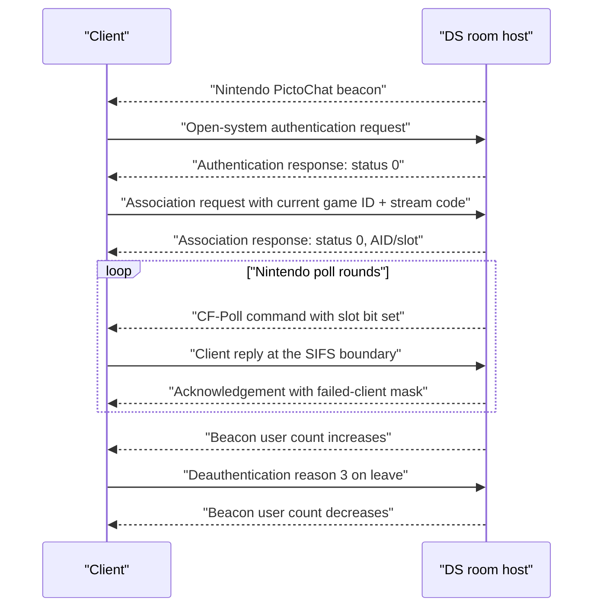

# Nintendo DS PictoChat protocol

This is Picto Relay's authoritative description of the PictoChat wire protocol as
currently understood. It is intended to be sufficient for implementing a compatible
client while making uncertainty explicit instead of assigning speculative meanings to
unknown bytes.

Last evidence update: **2026-08-20**.

## Current interoperability status

Picto Relay now interoperates with a physical Nintendo DS as a PictoChat Room A
client through an AR9271 adapter and custom firmware. The following milestones are
physically verified, not merely reproduced from captures:

| Capability | Status | Evidence |
|---|---|---|
| Discover a DS-hosted room | Verified | Nintendo beacon decoded on channel 1 |
| Authenticate and associate | Verified | Host assigns AID `0xc001`, participant slot 1 |
| Remain present in the room | Verified | Firmware answers targeted slot polls; beacon rises from one to two users |
| Publish nickname/profile | Verified | `PictoRelay` visibly appeared in the real DS participant list |
| Send a drawing | Verified | A generated 3x3 dot visibly rendered on the DS |
| Receive the host rebroadcast | Verified | All fourteen fragments reassembled to the original 2,084-byte drawing |
| Send more than one drawing per process | Implemented | Runtime message templates are one-shot and reloadable; messages queue in Rust |
| Multiple simultaneous virtual stations | Not implemented | Wire slots support it, current firmware owns one station/slot |

The radio timing portion is adapter-firmware work. Discovery, frame construction,
state tracking, drawing encoding, reassembly, and the JSON/REPL interface are Rust.

## Confidence labels

- **Verified** — observed repeatedly in captures of real Nintendo DS hardware.
- **Interoperability-verified** — emitted by Picto Relay and accepted by a real DS host.
- **Implemented** — behavior in the current codec/client, which may preserve opaque
  capture bytes without understanding them.
- **Inferred** — fits the captures but has not been isolated experimentally.
- **Unknown** — retained byte-for-byte; no semantic name should be attached yet.

The byte-level companion is [packet-shapes.md](packet-shapes.md). It contains larger
field tables and exact examples. This document concentrates on protocol layering,
state, timing, and the minimum behavior required for interoperability.

## Evidence provenance

Three captures are especially important:

| Capture | Participants | What it proves |
|---|---|---|
| `1787193673345-real-ds-clean-join-baseline.pcap` | Real DS host plus real DS client | Clean association, opening session reply, identity/profile exchange, idle membership, and leave |
| `session-state-fix-2.pcap` | Real DS host plus Picto Relay virtual client | Authentication, association into slot 1, opening session, both profile passes, sustained timed replies, two-user beacon, and clean leave |
| `1787275056402-virtual-client-outbound-dot-padded-final.pcap` | Real DS host plus Picto Relay virtual client | Complete virtual-client join and profile exchange, sixteen-frame drawing transaction, visible dot delivery, and all fourteen host-rebroadcast drawing fragments |

The clean real-client baseline used host `00:24:f3:67:41:87` and client
`00:25:a0:dc:81:df`. The successful virtual-client run used station
`00:16:56:b7:81:eb`, was held for 12 seconds, and produced:

- 1,405 host polls targeting slot 1;
- 1,381 accepted replies and 13 reported misses;
- 1,404 completed, clean firmware transmissions;
- both identity/profile passes completed; and
- a host beacon change from one to two users, followed by a clean return on leave; and
- the nickname `PictoRelay` visibly rendered in the physical DS participant list.

The packet-level results are captured, and the nickname display was independently
confirmed by direct observation of the physical DS LCD.

The outbound capture used host `00:24:f3:67:41:87`, virtual station
`00:09:bf:52:00:01`, and slot 1. Its canonical manifest and SHA-256 are in
[`captures/blueberry`](../captures/blueberry/README.md). It contains 162,390 decoded
Nintendo frames and one complete 2,084-byte drawing rebroadcast.

## Protocol stack

PictoChat is not IP traffic and does not use a normal Wi-Fi TCP/UDP connection.
It is an unencrypted Nintendo local-multiplayer protocol carried directly in raw
IEEE 802.11 management and data frames.

```text
capture only: radiotap
    ↓
IEEE 802.11 management or data frame
    ↓
Nintendo multiplayer flow prefix (host and acknowledgement only)
    ↓
PictoChat six-byte application envelope (when present)
    ↓
session / control / identity / message-fragment payload
```

Radiotap exists only between the Linux monitor interface and the capture program. It
is not transmitted over the air. FCS is likewise capture-dependent and must be removed
only when the radiotap flags say it is present.

## Complete join lifecycle



The application-level session and profile exchange happens inside the early poll
rounds; association alone is not enough to create a fully initialized PictoChat user.

## Room discovery

### Nintendo beacon element

The host sends ordinary 802.11 beacons containing vendor element `0xdd`. A PictoChat
element begins with Nintendo OUI/type `00 09 bf 00` and contains:

| Offset | Size | Meaning | Confidence |
|---:|---:|---|---|
| `0x00` | 4 | Nintendo OUI/type | Verified |
| `0x04` | 2 | Stepping offset | Externally documented |
| `0x06` | 2 | Video synchronization | Externally documented |
| `0x08` | 4 | Fixed/title value | Unknown |
| `0x0c` | 4 | Game/application ID | Verified as association input; semantics otherwise unknown |
| `0x10` | 2 | Session stream code | Verified as association input |
| `0x12` | 1 | Custom data length | Verified |
| `0x13` | 1 | Beacon type; `1` for this PictoChat/multicart shape | Verified |
| `0x14` | 2 | Host command capacity | Verified; `0x00c0` observed |
| `0x16` | 2 | Client reply capacity | Verified; `0x00c0` observed |
| `0x18` | variable | Type-specific data | Verified outer shape |

### PictoChat room data

For beacon type 1 with custom length 8:

```text
opaque_state: u32
room:         u8      # 0=A, 1=B, 2=C, 3=D
user_count:   u8      # includes the host
fixed_suffix: u16     # 0x0004 observed
```

`opaque_state` changes while room and membership remain constant, so it is not a
stable room or member identifier. The user count changing from 1 to 2 is the strongest
passive indication that a new participant has been admitted.

Our physical Room A work used 2.4 GHz channel 1. This does not establish a universal
room-to-channel mapping.

## Authentication and association

### Open-system authentication

The client sends management subtype 11 with:

```text
algorithm = 0
sequence  = 1
status    = 0
```

The host accepts with algorithm 0, sequence 2, status 0. The request uses the
power-management flag and observed duration `0x00a2`.

A radio-layer ACK matters. Physical testing showed that receiving the host's response
in monitor mode is insufficient when the host does not see its response acknowledged.
Picto Relay therefore keeps a managed interface with the virtual station MAC on the
same PHY while using a second monitor interface for capture/injection.

Authentication responses were only obtained with a Nintendo OUI station address in
our tests. Arbitrary unicast MACs received radio ACKs but did not complete the
management exchange. Treat the Nintendo-OUI requirement as **observed**, not as a full
allowlist definition.

### Nintendo association request

The association request is management subtype 0 with capabilities `0x0021`, listen
interval 1, and a 32-byte binary SSID element:

```text
binary_ssid[0..4] = beacon.game_id as little-endian u32
binary_ssid[4..6] = beacon.stream_code as little-endian u16
binary_ssid[6..32] = zero
```

It also advertises supported rates `0x82, 0x84` (1 and 2 Mbps basic rates). A real
client associates only milliseconds after a relevant beacon. Picto Relay refreshes
the beacon immediately before each attempt and copies its current stream code.

The successful host response used status 0 and association ID `0xc001`. The low nibble
is participant slot 1. In general:

```text
slot = association_id & 0x0f
poll_bit = 1 << slot
```

The first non-host participant therefore occupies slot 1 and is targeted by mask
`0x0002`. Preloading a predicted slot before association is safe only when the actual
assigned slot is checked; Picto Relay replaces its templates if the host chooses a
different slot.

## Nintendo multiplayer transport

Three Nintendo multicast addresses distinguish the flows:

| Flow | Address/layout | 802.11 subtype | Body prefix |
|---|---|---:|---|
| Host command | Address 1 `03:09:bf:00:00:00` | Data CF-Poll (`2`) | `client_time: u16`, `client_mask: u16` |
| Client reply | Address 1 = host, Address 3 `03:09:bf:00:00:10`, To-DS | Data (`1`) | none |
| Host acknowledgement | Address 1 `03:09:bf:00:00:03` | Data (`1`) | `command_count: u16`, `failed_client_mask: u16` |

There is no SNAP/LLC header in the captured Nintendo payload.

### Host command

```text
client_time:     u16
client_mask:     u16
command_payload: bytes
```

`client_mask` selects which participant slots may answer. Commands whose bit is not
set are still useful broadcasts but must not cause that client to transmit.

The dominant `client_time` in the original baseline was 998. Short host commands may
contain only the four-byte multiplayer header plus an opaque two-byte status; they are
not malformed application envelopes.

### Client reply

The client reply has no multiplayer prefix. Its MAC address placement is:

```text
Address 1 = host radio/BSSID
Address 2 = client station
Address 3 = 03:09:bf:00:00:10
To-DS    = 1
```

The captured DS uses data subtype 1, power-management set, 2 Mbps, and short preamble.
Observed non-envelope bodies include empty, `00 00`, and `00 80`.

### Host acknowledgement

```text
command_count:      u16
failed_client_mask: u16
```

Bit `1 << slot` set in `failed_client_mask` means that slot's reply was not accepted
for the corresponding round. The exact lifecycle of `command_count`, retry rules, and
the occasional mismatch between capture ordering and logical rounds remain unknown.

## Timing requirement

Correct bytes sent through an ordinary Linux packet socket are not sufficient. A DS
client replies immediately after its targeted CF-Poll, at the first SIFS opportunity.
The USB/userspace round trip misses this window.

The working AR9271 path retains reply templates in custom firmware and queues a reply
directly from the firmware RX path. In the successful virtual-client capture:

| Measurement | Result |
|---|---:|
| Target from RX clear to reply | 11 µs |
| Firmware queue time | 13/16/19 µs min/avg/max |
| Observed TX start | 18/21/366 µs min/avg/max |
| Starts within ±50 µs of target | 1,401 / 1,404 |
| Clean completions | 1,404 / 1,404 completed |

The large isolated maximum did not prevent sustained membership. These measurements
describe the current adapter/firmware and should not be generalized into a precise DS
hardware SIFS specification without more controlled captures.

## Application envelope

Application-bearing host commands and client replies begin with:

```text
packet_id:       u16
packet_sequence: u16
declared_length: u16
payload:         bytes
```

All multibyte fields in this document are little-endian unless stated otherwise.

The ordinary length convention depends on direction:

```text
host:   declared_length == payload.len
client: declared_length == payload.len + 2
```

Normally, the low byte of `packet_id` is the declared length in 16-bit words. For
example, `0x56 * 2 = 172`. The low nibble of the high byte selects a family; the
remaining high bits vary with direction/state and are not fully understood. Preserve
the exact ID even when dispatching on `packet_id & 0x7fff`.

There is one interoperability-verified exception. When the host rebroadcasts a short
client final fragment, the packet ID describes the **physical padded payload**, while
`declared_length` describes the **logical unpadded payload**:

```text
packet_id        = 0x9e56   # physical payload: 0x56 * 2 = 172 bytes
declared_length  = 16       # logical fragment payload
physical payload = 172 bytes
```

A decoder must recognize this host transfer-family exception before rejecting an
envelope for a length mismatch. It must not globally weaken the client-side rule.

### Observed families

| Family | Host IDs | Client IDs | Current use |
|---|---|---|---|
| `c34` | `0x1c34`, `0x9c34` | `0x8c34` | Member/session roster and opening client session response |
| `d0a` | `0x1d0a`, `0x9d0a` | `0x0d0a`, `0x8d0a` | Transfer announcement/control |
| `e30` | `0x1e30`, `0x9e30` | `0x0e30`, `0x8e30` | One 84-byte identity/profile fragment |
| `e56` | `0x1e56`, `0x9e56` | `0x8e56` | Full 160-byte message fragment; host also uses `0x9e56` for a physically padded short final |
| `e48`, `e38`, `e08` | direction/state variants | direction/state variants | Short/final transfer fragments |

## Session and identity initialization

The clean real-DS baseline corrected an important mistaken assumption: host `c34`
sequence 5 is the normal opening request. A real client answers with client `c34`
sequence 6. Picto Relay originally had this response preloaded but never selected it,
so the host repeated `c34` forever. Adding the missing opening-session state allowed a
real host to complete both identity passes.

### Working state machine

The following is the interoperability-verified template selector. Duplicate or
unrelated host packets receive idle replies without advancing the state.

| State | Host condition | Client reply | Next state |
|---|---|---|---|
| Wait session | `c34` | `c34` session response | Wait initial host profile |
| Wait initial host profile | `e30`, identity subtype 0 | Initial `d0a` announcement | Wait announcement echo |
| Wait announcement echo | `d0a` | Empty | Wait initial profile request |
| Wait initial profile request | `d0a` | Initial client `e30` profile | Wait initial profile echo |
| Wait initial profile echo | `e30`, subtype 0 | `00 80` idle | Wait initial completion gate |
| Wait initial completion gate | `c34` | Empty | Wait initial completion |
| Wait initial completion | `c34` | Initial `d0a` completion | Wait repeat announcement |
| Wait repeat announcement | `d0a` | Repeat `d0a` announcement | Wait final host profile |
| Wait final host profile | `e30`, subtype 1 | Empty | Wait final profile |
| Wait final profile | `c34` | Final client `e30` profile | Wait final profile echo |
| Wait final profile echo | `e30`, subtype 1 | `00 80` idle | Wait final completion |
| Wait final completion | `c34` | Final `d0a` completion | Steady |
| Steady | Any targeted poll | `00 80` idle | Steady |

This table describes the working responder, not proven semantic names for every
`c34`/`d0a` field. The responder preloads nine templates before association:

1. session response;
2. initial announcement;
3. empty reply;
4. initial profile;
5. initial completion;
6. repeat announcement;
7. final profile;
8. final completion; and
9. steady idle reply.

The empty and idle templates are reusable. Completion handling returns every retained
TX buffer to a ready state for the next matching poll.

### Session response

The opening response is client `0x8c34`, application sequence 6, declared length 104,
with 102 payload bytes. Four bytes near the beginning vary between real sessions. A
capture-derived value is currently accepted by the host, which suggests it is a client
nonce or opaque session value rather than a challenge response, but that interpretation
is only inferred.

### Identity/profile record

An `e30` fragment carries exactly 84 record bytes:

| Offset | Size | Field | Confidence |
|---:|---:|---|---|
| `0x00` | 1 | Record marker `3` | Verified |
| `0x01` | 1 | Identity subtype `0` or `1` | Verified |
| `0x02` | 6 | MAC as three little-endian 16-bit words | Verified |
| `0x08` | 20 | Nickname, fixed UTF-16LE, at most 10 code units | Verified |
| `0x1c` | 52 | Personal message, fixed UTF-16LE | Verified layout |
| `0x50` | 2 | Profile color | Capture-derived |
| `0x52` | 1 | Birthday byte | Capture-derived |
| `0x53` | 1 | Birthday byte | Capture-derived |

For MAC `00:16:56:4d:27:ca`, the stored bytes are `16 00 4d 56 ca 27`.
The order/validation rules for the two birthday bytes and the complete color mapping
remain unresolved.

## Drawing-message transfer

The outbound backend emits a variable-length transaction after profile initialization.
A one-band drawing uses sixteen replies:

| Reply index | Client packet | Purpose |
|---:|---|---|
| 0 | `d0a` | Announce a 2,084-byte transfer |
| 1–14 | `0x8e56` full fragments, then `0x8e08` final | Carry the drawing, application frame numbers 3 through 16 |
| 15 | `d0a` | Transfer completion/control record |

The custom firmware queues one transaction reply at each targeted poll. Rust stages
the first sixteen replies and then sends a private commit marker containing the total
logical reply count; firmware does not expose the transaction until that marker's TX
completion. The sixteen physical buffers are a circular window. Firmware maps logical
reply `n` to slot `n mod 16`, waits for the host acknowledgement, retries the same
reply when the virtual participant's failed bit is set, and makes the slot refreshable
after a successful acknowledgement. Rust uploads the next body while fifteen other
replies provide timing headroom. Firmware copies that body into the retained physical
buffer and returns the temporary upload directly to HTC; refill uploads are not sent
through the radio TX queue. A five-band 256x80 drawing uses 65 fragments and 67 total
replies. Private arm, refill, and commit markers never appear as Nintendo protocol
traffic.

Monitor capture is not lossless enough to pair every firmware transmission with an
individual host acknowledgement. The first hardware window test visibly rendered a
16-reply `HELLO` drawing while Linux observed only 15 drawing-reply markers. The
current private firmware interface therefore writes `0xA500 | cursor` into the
captured host command's duration field, where `cursor` is the cumulative number of
drawing replies accepted by the DS host. Rust advances and refills through that
cursor, so a later observation catches up any skipped monitor frames. This duration
encoding is applied to the post-reception copy only and is not part of PictoChat's
over-the-air protocol.

Host commands and acknowledgements can be pipelined, and monitor capture may omit an
acknowledgement entirely. Firmware therefore keeps the logical cursor fixed while a
drawing acknowledgement is unresolved and retransmits that drawing fragment on a
later targeted command. It must not substitute an idle reply: an acknowledgement for
that idle round can otherwise be mistaken for acceptance of the missing drawing and
advance the cursor. This failure was observed directly when a `HELLO` transfer
omitted offset `0x0640`, which contains the lower tile row of its final `O`. Duplicate
drawing fragments are tolerated in the tested one-band flow. The exact Nintendo
pipeline depth and acknowledgement association remain unknown.

A physical DS rendered the generated drawing, and its host rebroadcast all fourteen
fragments. That proves the announcement, client fragments, generated drawing metadata,
and completion sequence are sufficient for client-to-host delivery.

Transfer-family envelopes contain this fragment body:

```text
opaque_header[2]
data_length:   u8
final:         u8      # exactly 0 or 1
data_offset:   u16
opaque_id[2]
data[data_length]
frame_number:  u16
host_trailer:  u16     # host-to-client only; observed as 2
```

Client full fragments carry 160 message bytes and a two-byte frame number. Their
envelope declares two bytes more than are physically present, per the client length
convention. Ordinary full host rebroadcasts append the two-byte host trailer, so their
declared and physical payload lengths are equal.

One verified exception is the host rebroadcast of a short final fragment, which
occupies a full 160-byte transfer slot. In the canonical outbound capture:

```text
packet_id             0x9e56
packet_sequence       2
declared_length       16
opaque_header         01 04
data_length           4
final                 1
data_offset           0x0820
opaque_id             00 00
data                  00 00 00 00
padding               156 zero bytes
frame_number          43
host_trailer          2
physical payload      172 bytes
```

Padding sits between fragment data and the four-byte host trailer. A host-fragment
decoder must locate `frame_number` and `host_trailer` from the physical payload's end,
while taking exactly `data_length` bytes as message data. The client final fragment is
not padded: it uses packet ID `0x8e08`, a 14-byte physical payload, and declared length
16.

Completion is explicit (`final = 1`). A short payload is not by itself a final
fragment. Reassembly must use byte offsets, tolerate duplicates/out-of-order capture,
and reject conflicting overlaps.

### Reassembled message

A complete drawing is:

```text
metadata: 36 bytes
drawing:  N * 2048 bytes, where N is 1 through 5 bands
```

Each 2,048-byte band represents 256x16 pixels in Nintendo DS 8x8 tiled 4bpp order:

- tiles proceed left-to-right, then top-to-bottom;
- one tile is 32 bytes;
- the low nibble is the left pixel;
- the high nibble is the right pixel; and
- one through five bands produce heights 16, 32, 48, 64, or 80.

Our captures directly verify 256x16, 256x48, and 256x80 messages. The canonical
direct-return-ring capture contains five consecutive delivered drawings and ends with
a complete 10,276-byte five-band transfer.

The first 36 bytes are only partially decoded:

| Offset | Size | Meaning |
|---:|---:|---|
| `0x00` | 2 | Opaque metadata prefix |
| `0x02` | 6 | Sender MAC as three little-endian 16-bit words |
| `0x08` | 28 | Opaque metadata |
| `0x24` | remainder | Tiled 4bpp drawing |

Palette index 1 was black in a controlled capture. Other palette meanings and the
remaining metadata require isolated color/tool experiments.

## Leave

A real client leaves with 802.11 deauthentication management subtype 12, reason 3.
Picto Relay first sends a private firmware-disarm marker, then the deauthentication,
so the retained responder stops answering immediately and the host can release the
slot. The host subsequently advertises a reduced user count.

The private preload/disarm markers are an implementation channel between Picto Relay
and its custom AR9271 firmware. They are removed or redirected before transmission and
are **not part of the Nintendo protocol**.

## Minimal compatible-client requirements

A client that must interoperate with physical DS hardware needs all of the following:

1. Raw 2.4 GHz 802.11 monitor/injection access at 1/2 Mbps CCK rates.
2. A Nintendo-shaped unicast station MAC and hardware ACK support for management
   responses addressed to it.
3. Nintendo beacon parsing and a fresh game ID/stream code in the binary SSID.
4. Open-system authentication and association with the captured field shapes.
5. Slot extraction and `1 << slot` poll-mask filtering.
6. Replies at the SIFS boundary; ordinary userspace injection is too slow.
7. The opening `c34` session response and both profile passes.
8. Continued idle replies until leave.
9. For drawing transmission, the `d0a` announcement, offset-ordered `0x8e` fragments,
   explicit final marker, and `d0a` completion transaction.
10. Host-rebroadcast reassembly that understands the padded short-final exception.
11. Deauthentication reason 3 and immediate responder disarm.

An iPhone cannot perform this radio role directly with public APIs. In the Picto
Relay architecture, user interfaces are JSON API clients and the Raspberry Pi plus
compatible USB adapter is the raw-802.11 bridge.

## Multi-client implications

The Nintendo wire format supports multiple clients through association slots and the
host command/acknowledgement masks. Nothing in the protocol requires one phone only.
However, the current custom AR9271 firmware retains templates and a sixteen-buffer
message window for one virtual station and one slot at a time. Supporting several
simultaneous phones requires per-station:

- MAC identity and assigned slot;
- initialization state;
- nine generated/reusable initialization templates plus any staged message transaction;
- MAC and application sequence counters; and
- scheduling when one poll mask targets several clients.

This is an implementation limitation, not a demonstrated PictoChat protocol limit.

## Known unknowns

- Exact meaning and lifecycle of variable `c34` session bytes.
- Exact meanings of random/control bytes in `d0a` packets.
- High-bit variants in packet IDs (`0x1000`/`0x8000` behavior).
- `command_count` lifecycle and exact failed-client retry semantics.
- Opaque message-fragment header, transfer identifier, and host trailer.
- Most of the 36-byte drawing metadata.
- Full profile color and birthday encoding rules.
- Palette indices beyond observed black index 1.
- Simultaneous multiple virtual stations on one adapter.

## Executable implementation references

- `crates/picto-relay-codec/src/beacon.rs` — Nintendo and PictoChat beacon parsing.
- `crates/picto-relay-codec/src/frame.rs` — management/data frame construction.
- `crates/picto-relay-codec/src/transport.rs` — multiplayer, envelope, fragment, and
  reassembly codecs.
- `crates/picto-relay-join/src/main.rs` — active join and identity responder.
- `firmware/patches/0001-picto-relay-slot-reply.patch` — SIFS-timed AR9271 reply
  state machine.
- `crates/picto-relay-codec/tests/fixtures/host-padded-final-fragment.hex` — exact
  captured host rebroadcast that separates logical final length from physical slot size.
- `captures/blueberry/1787275056402-virtual-client-outbound-dot-padded-final.json` —
  canonical outbound capture manifest and hash.
- [packet-shapes.md](packet-shapes.md) — exact byte layouts and capture fixtures.

## External references

- [GBATEK: Nintendo beacons](https://problemkaputt.de/gbatek-ds-wifi-nintendo-beacons.htm)
- [GBATEK: IEEE 802.11 frames](https://problemkaputt.de/gbatek-ds-wifi-ieee802-11-frames.htm)
- [melonDS Wi-Fi implementation](https://github.com/melonDS-emu/melonDS/blob/master/src/Wifi.cpp)
- [Nintendo DS multiplayer Wireshark dissector](https://gist.github.com/alvinhochun/b7fb10bdfc7647c22847)
- [PictoChat reverse-engineering notes](https://matthil.de/w/pictochat.html)
- [PictoChat web bridge protocol notes](https://github.com/ksavill/pictochat-web-bridge/blob/main/docs/pictochat-protocol.md)
- [PictoChat Protocol Adapter](https://github.com/Thesola10/PictoChat)
- [ESP32 PictoChat host implementation](https://github.com/mjwells2002/pictochat-rs)
